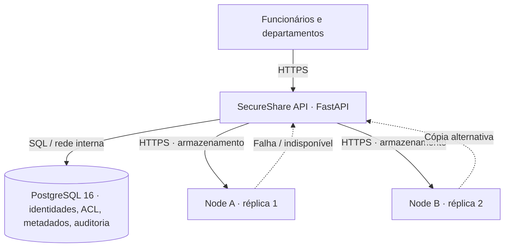

<div align="center">

# 🔐 SecureShare Universitário

### Partilha segura de documentos entre departamentos universitários

**ISUTC · Sistemas Distribuídos e Paralelos · 2026**


*Autenticação · Autorização · Replicação · Integridade · Auditoria*

</div>

---

## 📌 Visão geral

O **SecureShare** é um **protótipo académico de sistema distribuído** concebido para a partilha controlada de documentos digitais entre departamentos de uma instituição universitária, como **Registo Académico, Direcção Pedagógica, Recursos Humanos e Finanças**.

O problema abordado não é apenas enviar ficheiros: é definir **quem pode aceder**, **onde os documentos são guardados**, **como verificar que não foram alterados** e **o que acontece quando um dos nós de armazenamento deixa de responder**.

> **Âmbito:** demonstração e investigação académica com **dados fictícios**. Não é um produto certificado para produção, não substitui um sistema de gestão académica e não deve receber dados pessoais reais.

### Navegação

[Funcionalidades](#-funcionalidades) · [Arquitectura](#-arquitectura) · [Tecnologias](#-tecnologias) · [Instalação](#-instalação-e-execução) · [Demonstração](#-demonstração-académica) · [Testes](#-testes-e-estado-da-validação) · [API](#-api-rest) · [Segurança](#-segurança-e-limitações) · [Documentação](#-documentação)

## ✨ Funcionalidades

| Área | Implementação no protótipo |
|---|---|
| **Identidade** | Contas de utilizador, Argon2 para palavras-passe, JWT RS256, expiração e revogação no logout |
| **Organização** | Departamentos universitários e perfis `admin` / `user` |
| **Autorização** | Acesso por proprietário, destinatário individual ou departamento autorizado; administração não equivale a acesso automático ao conteúdo |
| **Gestão documental** | Envio, listagem, descarregamento, partilha, revogação e eliminação controlada |
| **Replicação** | Duas cópias por documento, em `node_a` e `node_b`, com estados persistentes e verificação de integridade |
| **Recuperação** | Tentativa de leitura pela segunda réplica e rotina de reconciliação de cópias ausentes/corrompidas |
| **Integridade** | Hashes SHA-256 verificados na gravação e recuperação |
| **Auditoria** | Registos de operações e acessos recusados |
| **Portal** | HTML, CSS e JavaScript; documentação OpenAPI gerada pelo FastAPI |

**Formatos permitidos:** PDF, TXT, CSV, DOCX, XLSX e PPTX. **Limite por ficheiro:** 20 MiB.

## 🏗 Arquitectura



**Componentes:** quatro contentores Docker (`api`, `postgres`, `node_a`, `node_b`). A API coordena os pedidos e esconde dos utilizadores a localização física das cópias. Os dois nós mantêm ficheiros em volumes Docker distintos.

**Atenção:** a API e o PostgreSQL continuam **pontos únicos de falha**. O mecanismo de fallback não garante alta disponibilidade de todo o sistema. Nesta demonstração, os serviços são independentes, mas executam na **mesma máquina física**.

## 🧰 Tecnologias

| Camada | Tecnologias |
|---|---|
| Interface | HTML5, CSS3, JavaScript |
| Backend | Python 3.12 (imagem Docker), FastAPI, Uvicorn |
| Base de dados | PostgreSQL 16 |
| Segurança | Argon2, JWT RS256, TLS local, credenciais de serviço, SHA-256 |
| Infraestrutura | Docker Desktop / Docker Compose, WSL 2 no Windows |
| Testes | Pytest; script de teste integrado `smoke_test.py` |

## 🚀 Instalação e execução

### Pré-requisitos

- **Windows 10/11** com Docker Desktop e mecanismo Docker Linux em execução (WSL 2 quando aplicável);
- **Python 3.12+ no computador** para gerar as credenciais e certificados locais;
- Acesso à internet no primeiro arranque, para obter as imagens e dependências.

> O backend é executado com **Python 3.12 dentro dos contentores**. Uma versão diferente do Python instalada no Windows não altera essa imagem.

### 1. Obter o código

No botão **Code → Download ZIP** do GitHub, transfira e extraia o projecto; ou clone o repositório:

```powershell
git clone https://github.com/armando-liedson-dev/secureshare-universitario.git
cd secureshare-universitario
```

> O endereço acima pressupõe que o repositório público seja criado com esse nome no perfil indicado. Se escolher outro nome, utilize a URL fornecida pelo GitHub.

### 2. Gerar credenciais locais (apenas na primeira instalação)

```powershell
python -m pip install cryptography
python scripts\bootstrap.py
```

O `bootstrap.py` cria `.env`, chaves JWT e certificados TLS de **laboratório**. **Nunca** publique esses ficheiros. Não execute o bootstrap novamente numa instalação já configurada: substituir chaves pode invalidar autenticações e causar indisponibilidades.

### 3. Iniciar os serviços

```powershell
docker compose up --build -d
docker compose ps
```

Verifique se `api`, `node_a` e `node_b` estão `Up` e `postgres` está `healthy`.

| Serviço | Endereço no computador local |
|---|---|
| Portal | **https://localhost:8000** |
| Swagger / OpenAPI | https://localhost:8000/docs |
| API health | https://localhost:8000/health |
| Node A | https://localhost:8001/health |
| Node B | https://localhost:8002/health |

Os certificados são gerados localmente e **não** pertencem a uma autoridade pública. O navegador poderá apresentar um aviso de confiança; utilize-os **apenas no ambiente de testes**. Para verificar o estado sem confiar no certificado local:

```powershell
curl.exe -k https://localhost:8000/health
```

A resposta esperada, quando a API estiver ligada à base de dados, é:

```json
{"status":"ok","database":"connected"}
```

### 4. Criar contas de demonstração

```powershell
# Cria um administrador interactivamente
docker compose exec api python -m app.create_admin

# Cria departamentos e contas fictícias
docker compose exec api python -m scripts.seed_demo
```

O script apresenta **palavras-passe aleatórias no terminal**, apenas para contas novas. Guarde-as em segurança; **não** as coloque em capturas de ecrã, commits, issues ou README. Se as contas já existirem, a execução repetida não redefine as suas palavras-passe.

> **Nota:** execute `seed_demo` com `python -m scripts.seed_demo`. A forma `python scripts/seed_demo.py` pode gerar `ModuleNotFoundError: No module named 'app'` neste ambiente.

### 5. Parar e retomar, sem apagar os dados

```powershell
docker compose stop        # parar
docker compose start       # retomar
docker compose ps          # verificar
docker compose logs --tail=50 api
```

**Nunca execute `docker compose down -v` para simplesmente parar o projecto:** `-v` remove os volumes persistentes do PostgreSQL e dos dois nós, causando perda dos dados locais.

## 🧪 Demonstração académica

**Cenário com dados fictícios:**

1. O utilizador `registo` carrega uma pauta fictícia pelo portal.
2. A API valida o pedido, regista os metadados e tenta guardar **duas réplicas**.
3. O proprietário partilha o documento com `direccao` ou com o departamento Direcção Pedagógica.
4. A Direcção tenta listar e descarregar o ficheiro; um utilizador de RH **sem permissão** deve receber acesso negado.
5. Paramos o `node_a` e verificamos se o download continua através de `node_b`.
6. Reiniciamos o `node_a` e verificamos o estado das réplicas e a reconciliação.
7. Consultamos o registo de auditoria.

Comandos para o teste de falha **apenas depois de existir um documento com duas réplicas íntegras**:

```powershell
docker compose stop node_a
# Testar o download na interface do utilizador autorizado
docker compose start node_a
```

Para a defesa, registe as evidências do estado de cada serviço e os resultados observados, sem divulgar credenciais.

## ✅ Testes e estado da validação

O projecto inclui testes de código e um teste integrado. **Funcionalidade implementada não significa funcionalidade já aprovada em teste ponta a ponta.**

### Testes automatizados

```powershell
python -m pip install -r requirements-dev.txt
python -m pytest -q
```

**Teste integrado** (com os quatro contentores em execução, cria dados de teste):

```powershell
docker compose exec api python scripts/smoke_test.py --base https://api:8000
```

O teste pede as credenciais do administrador local, valida os principais fluxos e **cria contas, um departamento e um documento fictício** na base de dados de demonstração.

### Evidências disponíveis (12/10/2026)

| Verificação | Estado documentado |
|---|---|
| Quatro contentores `Up`; PostgreSQL `healthy` | ✅ Confirmado no ambiente do grupo |
| `GET /health`: API ligada ao PostgreSQL | ✅ Confirmado |
| Criação de administrador e departamentos | ✅ Confirmado |
| Login no portal e upload do documento fictício #3 (`registo`) | ✅ Confirmado |
| Duas réplicas confirmadas *directamente* nos nós | ⏳ Por verificar |
| Partilha visível para `direccao` | ⏳ Por verificar; a autorização individual ainda não estava registada na consulta SQL |
| Bloqueio do acesso de `rh` | ⏳ Por verificar |
| Download durante indisponibilidade do `node_a` | ⏳ Por verificar |
| Reparação após reposição do nó | ⏳ Por verificar |

A interface apresentou a confirmação «Documento #3 replicado nos dois nós», mas isso **não substitui a verificação independente**. Não são atribuídas melhorias quantitativas sem medições reproduzíveis.

Consulte [o roteiro de testes e defesa](DEFESA_E_TESTES.md) e [o registo de resultados](TEST_RESULTS.md).

## 🔗 API REST

Algumas rotas disponibilizadas (a documentação completa é gerada em [`/docs`](https://localhost:8000/docs)):

| Método | Endpoint | Finalidade |
|---|---|---|
| `POST` | `/auth/login` | Autenticação |
| `GET` | `/auth/me` | Sessão e perfil |
| `POST` | `/auth/logout` | Revogação de token |
| `GET` | `/departments` | Departamentos |
| `POST` | `/documents` | Envio de documento |
| `GET` | `/documents` | Documentos autorizados |
| `GET` | `/documents/{id}/download` | Descarregamento |
| `POST` | `/documents/{id}/share` | Partilha individual |
| `POST` | `/documents/{id}/share-department` | Partilha por departamento |
| `DELETE` | `/documents/{id}/share/{username}` | Revogar partilha individual |
| `GET` | `/admin/replicas` | Estado das réplicas (admin) |
| `POST` | `/admin/reconcile` | Reconciliar réplicas (admin) |
| `GET` | `/audit` | Auditoria (admin) |

## 📂 Organização do repositório

```text
secureshare-universitario/
├── app/                     # API e serviços de backend
│   ├── main.py
│   ├── auth.py
│   ├── documents.py
│   ├── admin.py
│   ├── storage_client.py
│   ├── storage_node.py
│   ├── security.py
│   └── db.py
├── web/                     # Interface HTML, CSS, JavaScript
├── tests/                   # Testes com Pytest
├── scripts/                 # Inicialização, dados fictícios e testes integrados
├── docs/                    # Materiais do trabalho e guia de publicação
├── compose.yaml             # API, PostgreSQL, Node A, Node B
├── Dockerfile
├── requirements.txt
├── requirements-dev.txt
├── .env.example              # Exemplo SEM credenciais verdadeiras
├── .gitignore
├── SECURITY.md
└── README.md
```

## 🔒 Segurança e limitações

- **Não publicar:** `.env`, chaves privadas, certificados gerados, palavras-passe, bases de dados locais, ficheiros reais de utilizadores ou logs sensíveis.
- Os dois nós são redundantes **apenas para ficheiros**; API e PostgreSQL podem interromper todo o serviço.
- **Replicação não é backup:** uma eliminação ou corrupção propagada pode atingir ambas as cópias.
- Os ficheiros nos volumes **não estão cifrados em repouso**; a comunicação com o PostgreSQL pela rede interna não utiliza TLS nesta versão.
- Certificados TLS locais são para **demonstração**, não para produção.
- A verificação de tipos de ficheiro não substitui análise antimalware; não existem ensaios de carga ou auditoria de segurança externa.
- As permissões revogadas impedem **novos acessos** pela API, mas não apagam cópias anteriormente descarregadas.

Para uma análise mais detalhada, consulte [SECURITY.md](SECURITY.md).

## 📚 Documentação

| Documento | Conteúdo |
|---|---|
| [DEFESA_E_TESTES.md](DEFESA_E_TESTES.md) | Demonstração e testes académicos |
| [MELHORIAS_REALIZADAS.md](MELHORIAS_REALIZADAS.md) | Evolução do protótipo |
| [TEST_RESULTS.md](TEST_RESULTS.md) | Registo e limites dos testes |
| [SECURITY.md](SECURITY.md) | Modelo de ameaças e recomendações |
| [docs/GITHUB_PUBLICACAO.md](docs/GITHUB_PUBLICACAO.md) | Guia para publicar sem divulgar segredos |
| [docs/academico/](docs/academico/) | Relatório e apresentação académica (rascunhos) |

## 👥 Contexto académico

Projecto desenvolvido no âmbito da disciplina **Sistemas Distribuídos e Paralelos**, do **Instituto Superior de Transportes e Comunicações (ISUTC)**, Moçambique, ano lectivo **2026**.

**Docente:** MSc. Sérgio J. Sambo  
**Autores:** *a completar pela equipa*.

---

<div align="center">

**SecureShare — Documentos acessíveis apenas a quem tem autorização.**

*Código aberto para consulta pública como trabalho académico; condições de reutilização dependem da licença que a equipa vier a adoptar.*

</div>
